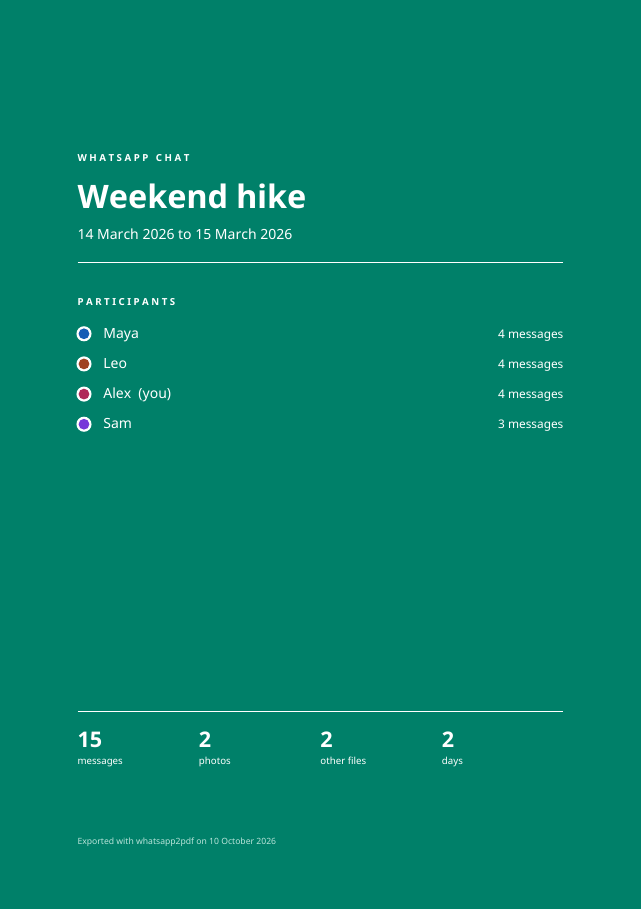
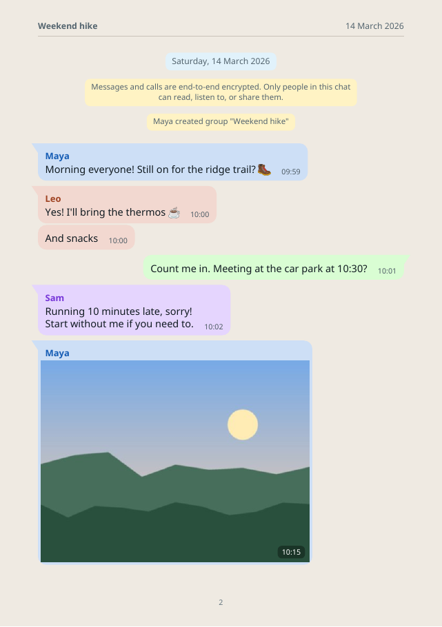

# whatsapp2pdf

Turn a WhatsApp chat export into a bubble-style PDF you can keep, print or archive. It includes photos, emoji and a cover page.

<div markdown style="display:flex;gap:1rem;flex-wrap:wrap">
{ width="320" }
{ width="320" }
</div>

*Both pages come from a made-up group chat; see `scripts/make_demo.py`.*

## Quick start

```bash
pipx install whatsapp2pdf          # or: pip install whatsapp2pdf
whatsapp2pdf "WhatsApp Chat - Family.zip" family.pdf --me "Your Name"
```

1. [Export the chat](export.md) from your phone, with or without media.
2. Run `whatsapp2pdf` on the `.zip` (or the `.txt`).
3. Open the PDF. Your messages appear on the right in green, and everyone else gets their own color on the left.

## What you get

- A **cover page** with the chat title, date range, participants and totals.
- **Day separators**, sender names, timestamps, and grouping of consecutive messages.
- **Inline photos**, plus cards for audio, video, documents and contacts.
- **Large emoji** for emoji-only messages, drawn from your system's color emoji font.
- **A4, A5 or A6** pages, and a plain white mode for cheaper printing.
- **Large exports** of several gigabytes work: messages are streamed and media is read straight from the ZIP.

## Private by design

Everything runs on your computer. No upload, no account, no network access. See [Privacy & security](privacy.md).

---

whatsapp2pdf is open source under the MIT License. It is not affiliated with WhatsApp or Meta.
